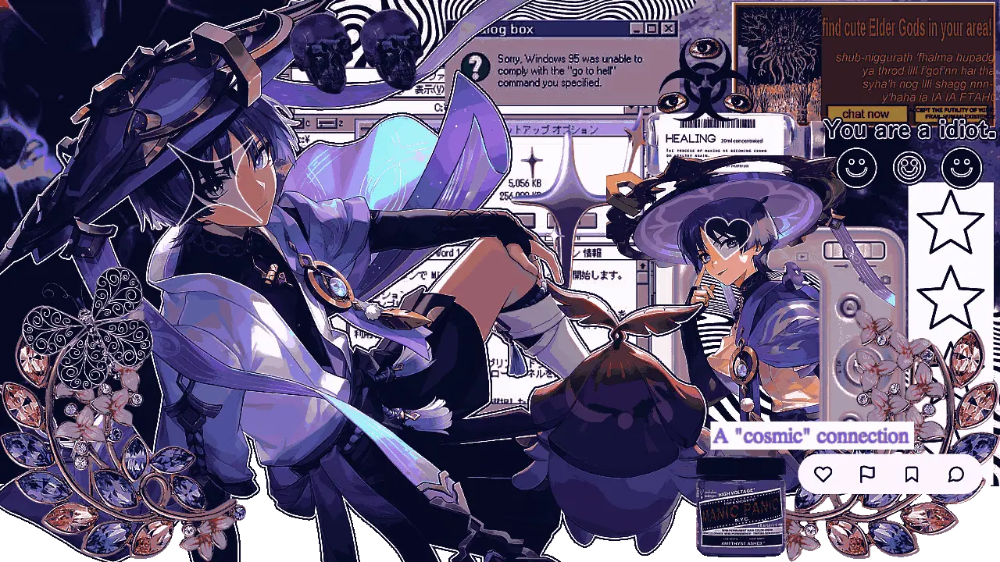
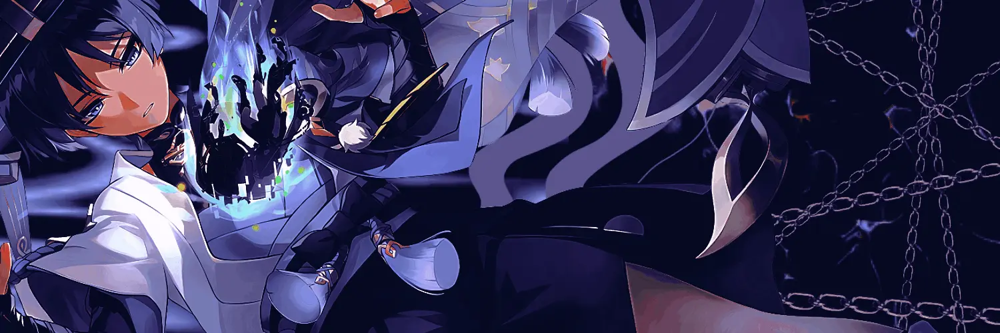

  

  

  

  <tr>
    <td><a href="https://wandererswifey.straw.page/"> Strawpage</a></td>
    <td><a href="https://wandererswife.atabook.org/?page=1"> Atabook</a></td>
    <td><a href="https://www.wattpad.com/story/417207126-about-my-yumeship"> About my Yumeship</a></td>
    <td><a href="https://open.spotify.com/playlist/5aRACuZt1kolPsSgVdxKFo"> Yumeship playlist</a></td>
  </tr>
</table>

 

  

  

 

  &nbsp;&nbsp;Friends I cherish close to me!
 
${\textsf{\color{#1F51FF} Irene, Chii, Mei,Kuro}}$
${\textsf{\color{#1F51FF} Stanley, Enid, Jay, Mikyii}}$
${\textsf{\color{#1F51FF} Venus, Vix, Crissy, Isaac/Crystal!}}$

  &nbsp;&nbsp;About me!
 
${\textsf{\color{#0047AB} Call me Haru! I am 20 and she her hers!}}$
${\textsf{\color{#6495ED} I'm aroace and pan! <33}}$
${\textsf{\color{#0047AB} Mentally ill, currently saving for a therapist irl to get rediagnosed..}}$
${\textsf{\color{#6495ED} I'm a voidsharing Wanderer yumeshipper, Riako and soulbonded!}}$
${\textsf{\color{#0047AB} I have moodswings, I over think ALOT, and can easily become overwhelmed}}$
${\textsf{\color{#6495ED} I ALSO LOVEEEEE MAKING FRIENDS PLS ASK ME TO BE OOMFS I DONT BITE <3333 }}$

 

  &nbsp;&nbsp;byi!
 
${\textsf{\color{#0047AB} I'm an adult, so people under 15 dni or interact with extreme caution!}}$
${\textsf{\color{#6495ED} I'm a very sensitive person, so please be patient with me!}}$
${\textsf{\color{#0047AB} I'm VERY protective of Wanderer, so please be aware of that.}}$
${\textsf{\color{#6495ED} If you have a problem with me, then just block me.}}$
${\textsf{\color{#0047AB} Do not throw insults my way, simply hide me and move on.}}$
${\textsf{\color{#6495ED} Wanderer kins int with EXTREME caution, dont act like im your gf either.}}$

 

  &nbsp;&nbsp;HEAVY DNI!
 
${\textsf{\color{#6495ED} ANY Wanderer ships in general, HEAVYYYYYY DNI. I block freely.}}$
${\textsf{\color{#0047AB} Dni if you openly call wanderer a "Twink" or "Tsundere". It makes me super uncomf.}}$
${\textsf{\color{#6495ED} And those who have a problem with me/have been harassing me, DNI. BLOCK ME. I DO NOT CARE. Leave me alone.}}$

 

  &nbsp;&nbsp;dni!
 
${\textsf{\color{#0047AB} Wanderer yumes HEAVY dni.}}$
${\textsf{\color{#6495ED} Wanderer ships in general dni.}}$
${\textsf{\color{#0047AB} Basic dni, etc etc.}}$
${\textsf{\color{#6495ED} Ex friends dni. I don't want to int with you.}}$
${\textsf{\color{#0047AB} TFC, Hellaverse, Roblox (unless friends), DDLC, alnst (unless friends, dni!)}}$
${\textsf{\color{#6495ED} Anti Yumeshippers as a whole just dni.}}$

  

  &nbsp;&nbsp;why I love Wanderer!
 
${\textsf{\color{#1F51FF} big yapping warning, will include a bunch of stuff!}}$

  &nbsp;&nbsp;why do I yumeship!
 
${\textsf{\color{#0047AB} I yumeship as a coping mechanism! Wanderer is very personal to me in that regard.}}$
${\textsf{\color{#6495ED} It has saved my life, and the love feels very real to me!}}$
${\textsf{\color{#0047AB} I find comfort in yumeshipping with Wanderer, he is my husband in my eyes!!}}$
${\textsf{\color{#6495ED} I am voidsharing, which means I prefer to not acknowledge my doubles.}}$
${\textsf{\color{#0047AB} I am a Riako, which means the love for Wanderer feels real.}}$
${\textsf{\color{#6495ED} I am soulbonded, which means I am spiritually bonded to Wanderer!}}$

  &nbsp;&nbsp;His backstory
 
${\textsf{\color{#6495ED} Wanderers gone through so much. More than people realize. Many ignore his trauma to bicker or mock him.}}$
  ${\textsf{\color{#0047A} It bugs me when people call Wanderer a "brat" or "annoying."}}$
  ${\textsf{\color{#6495ED} I get it if you dislike him because hes not your type of character. But don't insult those who love him.}}$
  ${\textsf{\color{#0047A} He's gone through unbearable torture that he wouldn't have survived if he weren't an immortal puppet.}}$
  ${\textsf{\color{#6495ED} He's lost many in his life, while wandering for centuries, serving the fatui, bitter at the world.}}$
  ${\textsf{\color{#0047A} Which is exactly why he acts the way he does, why he's cold, mocking, and so on.}}$
  ${\textsf{\color{#6495ED} He may have learned that his past betrayals were anything but. Only to learn it was Dottores doing.}}$
  ${\textsf{\color{#0047A} But the fear of being hurt again, the fear of being abandoned, it never went away with him. Which is reasonable.}}$
  ${\textsf{\color{#6495ED} Which is why he is brutally honest, often mocking his peers or teasing them. He is scared of being hurt again.}}$
  ${\textsf{\color{#0047A} Which is why it bugs me when people bash him. I'm not saying you can't like him.}}$
    ${\textsf{\color{#6495ED} All I ask is to take the time to look into his trauma, his past, and how he acts now.}}$
    ${\textsf{\color{#0047A} If you were hurt time and time again, would you be cheerful, or would you be afraid to be hurt again?}}$

  &nbsp;&nbsp;His eyes
 
${\textsf{\color{#6495ED} Wanderers eyes calm me. They're majestic, beautiful, and gorgeous.}}$
  ${\textsf{\color{#0047A} I feel that when I look at him, I feel as if i'm looking at his soul.}}$
  ${\textsf{\color{#6495ED} One look into his eyes, and I forget how to breathe. How to function.}}$
  ${\textsf{\color{#0047A} Whenever he appears, I always gaze into his eyes. His beautiful eyes.}}$
  ${\textsf{\color{#6495ED} The beautiful colors, they give me this gentle feeling, like i'm on a cloud.}}$
  ${\textsf{\color{#0047A} Not to mention how they express how wanderer himself feels.}}$
  ${\textsf{\color{#6495ED} The way he narrows his eyes when he's thinking, or they shift when he's stubborn.}}$
  ${\textsf{\color{#0047A} They often give me butterflies. I know it's silly, but they do.}}$

  &nbsp;&nbsp;His personality
 
${\textsf{\color{#6495ED} He may be cold, standoffish, or stubborn. But theres more to Wanderer than that.}}$
  ${\textsf{\color{#0047A} He more acts to express himself, rather than show it in words.}}$
  ${\textsf{\color{#6495ED} He knows when to show he cares, he knows when a situation calls for it.}}$
  ${\textsf{\color{#0047A} But he also knows when to bring you back to reality. To set you straight.}}$
  ${\textsf{\color{#6495ED} Wanderer is the type to be brutally honest with good intentions.}}$
  ${\textsf{\color{#0047A} If you're about to do something stupid, he will tell you, and maybe gently guide you to the right path.}}$
  ${\textsf{\color{#6495ED} But if you continue to do said thing, he'll just let you learn from your mistakes and help if life is in danger.}}$
  ${\textsf{\color{#0047A} I hate when people call him a tsundere. He's not. He's just scared to let people in, in fear of being hurt.}}$
  ${\textsf{\color{#6495ED} He's the type to let someone in if he truly feels comfortable enough to do so.}}$

  &nbsp;&nbsp;What he represents
 
${\textsf{\color{#6495ED} To me, Wanderer represents growth from trauma.}}$
  ${\textsf{\color{#0047A} He represents feeling trapped within your own self. To feel trapped with people you're supposed to call family.}}$
  ${\textsf{\color{#6495ED} I've felt like that numerous times. Which is partly why he's personal to me.}}$
  ${\textsf{\color{#0047A} He also represents freedom. To slowly be okay with yourself, to slowly heal.}}$
  ${\textsf{\color{#6495ED} He also is represented by cats. Cats, to me, in his symbolism are very important.}}$
  ${\textsf{\color{#0047A} Cats tend to come to you if you are gentle with them, if you are }}$
  ${\textsf{\color{#6495ED} They often don't show their true colors unless they're comfortable with you.}}$
  ${\textsf{\color{#0047A} Just like him.}}$

  &nbsp;&nbsp;How I fell for him
 
${\textsf{\color{#6495ED} Believe it or not, I first hated Wanderer.}}$
  ${\textsf{\color{#0047A} I hated how he appeared everywhere, and that was my whole reason.}}$
  ${\textsf{\color{#6495ED} But then I truly met him in Genshin, I saw his trauma, and I saw him for him.}}$
  ${\textsf{\color{#0047A} I realized how much I related to him. I realized how much I loved him.}}$
  ${\textsf{\color{#6495ED} I feel like I truly bonded with him, connected.}}$
  ${\textsf{\color{#0047A} Especially with being soulbonded now.}}$
  ${\textsf{\color{#6495ED} I feel like I'm truly in love.}}$

  &nbsp;&nbsp;His character development
 
${\textsf{\color{#6495ED} Wanderer as of now, has truly grown from his past.}}$
  ${\textsf{\color{#0047A} He still struggles with learning to love himself.}}$
  ${\textsf{\color{#6495ED} He often doesn't care what happens to himself, as long as his peers are safe.}}$
  ${\textsf{\color{#0047A} But then he takes the time to take care of himself, and make sure he's in top shape.}}$
  ${\textsf{\color{#6495ED} This in itself is a sign of character growth.}}$
  ${\textsf{\color{#0047A} He cares for his peers, his friends, and it shows.}}$
  ${\textsf{\color{#6495ED} It truly shows when he's caring for Durin as well.}}$
  ${\textsf{\color{#0047A} In a way, It's obvious he's trying to care for durin like a father, to give him a childhood hes never had.}}$

  &nbsp;&nbsp;His voice
 
${\textsf{\color{#6495ED} Whenever I get sad, I think of Wanderer, and what he'd do.}}$
  ${\textsf{\color{#0047A} His voice is the first thing that pops in my head.}}$
  ${\textsf{\color{#6495ED} I adore Wanderers voice, I often look for videos with his voice in it.}}$
  ${\textsf{\color{#0047A} They do well to calm me, and I feel like I can focus and relax.}}$
  ${\textsf{\color{#6495ED} Often I'll be upset, and then I'll think of him talking me through it.}}$
  ${\textsf{\color{#0047A} Which, is something he'd do. Hes the type to gently guide you, or bring you back to reality.}}$
  ${\textsf{\color{#6495ED} It's helped me through some really tough times in life.}}$

  &nbsp;&nbsp;What he means to me
 
${\textsf{\color{#6495ED} Wanderer is super personal to me. To some, it may seems unhealthy, but It helps me.}}$
  ${\textsf{\color{#0047A} Many often harass me over it, and I feel its unreasonable as I don't hurt anyone.}}$
  ${\textsf{\color{#6495ED} Yumeshipping with him has gotten me through some dark times in my life.}}$
  ${\textsf{\color{#0047A} I wouldn't be alive and breathing if it weren't for Wanderer.}}$
  ${\textsf{\color{#6495ED} I adore him with all my heart, and I feel so connected to him in such a deep way.}}$
  ${\textsf{\color{#0047A} Which is why he's so personal to me. Yes, I know. I'm mentally ill.}}$
  ${\textsf{\color{#6495ED} But I don't harm anyone. I block and move on. That's it!}}$

  &nbsp;&nbsp;Why ships with him make me uncomf
 
${\textsf{\color{#6495ED} For me, ANY Wanderer ships make me INSANELY uncomfortable.}}$
  ${\textsf{\color{#0047A} That includes yumeships, oc x canon, self ships, and ships with him and other characters.}}$
  ${\textsf{\color{#6495ED} The reason is, I feel super uncomfortable as it feels like seeing your lover cheat on you.}}$
  ${\textsf{\color{#0047A} I yumeship as a coping mechanism, and because it makes me happy and feel loved.}}$
  ${\textsf{\color{#6495ED} Harass me all you want. I don't care anymore. This makes me happy, so deal with it!}}$
  ${\textsf{\color{#0047A} This doesn't mean I come after those who ship Wanderer with characters.}}$
  ${\textsf{\color{#6495ED} I usually block those who openly ship him with characters. I NEVER Harass anyone.}}$
  ${\textsf{\color{#0047A} If you openly yumeship with wanderer, I block on sight immediately. It doesn't hurt you. Dont come at me.}}$
  ${\textsf{\color{#6495ED} Just understand its personal boundaries, and that it's nothing personal towards you.}}$

  &nbsp;&nbsp;How'd I come up with my yumesona?
 
${\textsf{\color{#6495ED} I REALLY love birds. I feel they represent me in a way. Often feeling caged, working to be free.}}$
  ${\textsf{\color{#0047A} So, I made my yumesona, Harukas lore, heavily about Dove Birds.}}$
  ${\textsf{\color{#6495ED} I've also made her share a past with wanderer, not EXACTLY, but they share trauma they went through together.}}$
  ${\textsf{\color{#0047A} This is because I relate to wanderer heavily. Which is why I made her share a past.}}$
  ${\textsf{\color{#6495ED} She is a traveling doctor, because like me, she wants to help other people in the world.}}$
  ${\textsf{\color{#0047A} She's lost family, just like Wanderer, and had felt trapped just like I do in my own home.}}$
  ${\textsf{\color{#6495ED} I chose Doves. Specifically albino mourning dove, as it represents nostalgia for the past.}}$

  

  

