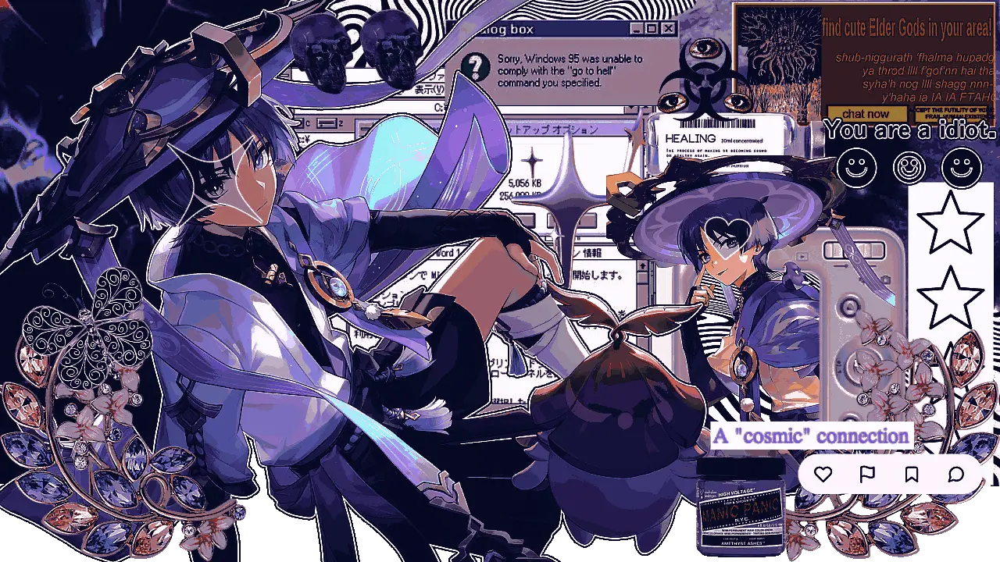
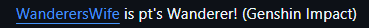
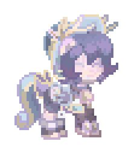
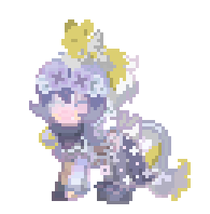
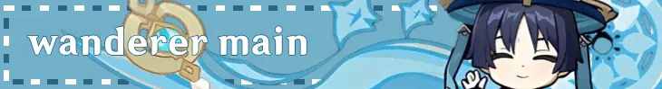
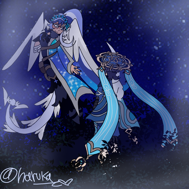

  

  

  <tr>
    <td><a href="https://wandererswifey.straw.page/"> Strawpage</a></td>
    <td><a href="https://wandererswife.atabook.org/?page=1"> Atabook</a></td>
    <td><a href="https://www.wattpad.com/story/417207126-about-my-yumeship"> About my Genshin Sona</a></td>
  </tr>
</table>

 

  &nbsp;&nbsp;HEAVY DNI!
 
${\textsf{\color{#F0FFFF} Scaralumi, scaraaether, ANY scara ships, but SCARALUMI specifically NEVER INT, you guys make me SO uncomf,}}$
${\textsf{\color{#F0FFFF} The ship makes me physically ill and uncomfortable, and the shippers are toxic asf. Leave me alone.}}$
${\textsf{\color{#F0FFFF} And those who have a problem with me/have been harassing me, DNI. BLOCK ME. I DO NOT CARE. Leave me alone.}}$

 

  &nbsp;&nbsp;About me!
 
${\textsf{\color{#89CFF0} Call me Haru! I am 20 and she her hers!}}$
${\textsf{\color{#B6D0E2} I'm aroace and pan! <33}}$
${\textsf{\color{#89CFF0} Mentally ill, currently saving for a therapist irl to get rediagnosed..}}$
${\textsf{\color{#B6D0E2} I'm a voidsharing Wanderer yumeshipper, Riako and soulbonded!}}$
${\textsf{\color{#89CFF0} I have moodswings, I over think ALOT, and can easily become overwhelmed}}$
${\textsf{\color{#B6D0E2} I ALSO LOVEEEEE MAKING FRIENDS PLS ASK ME TO BE OOMFS I DONT BITE <3333 }}$

 

  &nbsp;&nbsp;byi!
 
${\textsf{\color{#89CFF0} I'm an adult, so people under 15 dni or interact with extreme caution!}}$
${\textsf{\color{#B6D0E2} I'm a very sensitive person, so please be patient with me!}}$
${\textsf{\color{#89CFF0} I'm VERY protective of Wanderer, so please be aware of that.}}$
${\textsf{\color{#B6D0E2} If you have a problem with me, then just block me.}}$
${\textsf{\color{#89CFF0} Do not throw insults my way, simply hide me and move on.}}$
${\textsf{\color{#B6D0E2} Wanderer kins int with EXTREME caution, dont act like im your gf either.}}$

 

  &nbsp;&nbsp;dni!
 
${\textsf{\color{#89CFF0} Wanderer yumes HEAVY dni.}}$
${\textsf{\color{#B6D0E2} Wanderer ships in general dni.}}$
${\textsf{\color{#89CFF0} Basic dni, etc etc.}}$
${\textsf{\color{#B6D0E2} Ex friends dni. I don't want to int with you.}}$
${\textsf{\color{#89CFF0} TFC, Hellaverse, Roblox (unless friends), DDLC, alnst (unless friends, dni!)}}$
${\textsf{\color{#B6D0E2} Anti Yumeshippers as a whole just dni.}}$

  &nbsp;&nbsp;why do I yumeship!
 
${\textsf{\color{#89CFF0} I yumeship as a coping mechanism! Wanderer is very personal to me in that regard.}}$
${\textsf{\color{#B6D0E2} It has saved my life, and the love feels very real to me!}}$
${\textsf{\color{#89CFF0} I find comfort in yumeshipping with Wanderer, he is my husband in my eyes!!}}$
${\textsf{\color{#B6D0E2} I am voidsharing, which means I prefer to not acknowledge my doubles.}}$
${\textsf{\color{#89CFF0} I am a Riako, which means the love for Wanderer feels real.}}$
${\textsf{\color{#B6D0E2} I am soulbonded, which means I am spiritually bonded to Wanderer!}}$

  &nbsp;&nbsp;why I love Wanderer! big yapping warning lol
 
${\textsf{\color{#89CFF0} Firstly, I used to hate Wanderer. Before I returned to genshin, I saw him everywhere, and I hated him because of it.}}$
${\textsf{\color{#B6D0E2} Then I met him in game for the first time, it was around fontaines arc, I had rejoined for Lyney first.}}$
${\textsf{\color{#89CFF0} As I learned about his story, and the trauma he had gone through, I realized I kinned him heavily.}}$
${\textsf{\color{#B6D0E2} I know how it feels to be seen as a tool, only to be discarded. To be abandoned by those who were supposed to love you.}}$
${\textsf{\color{#89CFF0} I know how it feels to lose companions who were meant to be there for you, because of things beyond your control.}}$
${\textsf{\color{#B6D0E2} And I absolutely know how it feels to be angry at the world, to hate everything and put up walls to not be hurt again.}}$
${\textsf{\color{#B6D0E2} After I learned of his story, and his redemption arc as a now playable character, I realized something.}}$
${\textsf{\color{#89CFF0} I loved him. Loved him more than I've loved someone before. And in a way, it terrified me.}}$
${\textsf{\color{#B6D0E2} Usually with fictional crushes of mine, I tend to gravitate towards them, then move on like its a phase. Which usually it is.}}$
${\textsf{\color{#89CFF0} But over two years ago. July 4th 2024. Is when I fell in love with him, and never looked back since.}}$
${\textsf{\color{#B6D0E2} I started to notice the little things about him. His quirks, things he liked, things he didn't like.}}$
${\textsf{\color{#89CFF0} I deep dived into his backstory over and over, researching about him, wanting to know everything about him.}}$
${\textsf{\color{#B6D0E2} I wanted to learn more about him, looking between the lines of his story, voicelines, cutscenes, expressions, etc.}}$
${\textsf{\color{#89CFF0} It may seem silly to some, but to me, this is what makes me happy. I love and feel close to him.}}$
${\textsf{\color{#B6D0E2} I even made a Genshin Persona that resembles me. She shares a past with Wanderer, since I kin him, and sharing pasts is fitting.}}$
${\textsf{\color{#89CFF0} It's essentially a childhood friends to enemies to lovers troupe. Where they met when Wanderer was first set free by Ei.}}$
${\textsf{\color{#B6D0E2} Ever since then, It's been my main hyperfixation. I even learned to shift realities with the help of a friend, just to see him.}}$
${\textsf{\color{#89CFF0} Yumeshipping with Wanderer has even saved my life. When I'm upset, at my lowest, I'll think of him and what he'd do.}}$
${\textsf{\color{#B6D0E2} There's things that scare me, but I've learned to accept them, just like he has. I've learned its okay to be scared.}}$
${\textsf{\color{#89CFF0} I've even learned how to soulbond with him. If you don't know what that is, I do suggest looking it up!}}$
${\textsf{\color{#B6D0E2} I used to think I was crazy, being jealous or uncomfortable with people shipping Wanderer with other characters.}}$
${\textsf{\color{#89CFF0} To me, he is not. To me, he is my partner, my husband, my other half. And this is why I am now Voidsharing with him.}}$
${\textsf{\color{#B6D0E2} I've learned to ignore and block those who don't understand the depths of my feelings, or insult me for it.}}$
${\textsf{\color{#89CFF0} If you are someone who thinks throwing insults my way will "save me" from being mentally ill, it will not. You make it worse.}}$
${\textsf{\color{#B6D0E2} Alot of this is why I feel so close to Wanderer. To me, he is as real as a character from a game can get.}}$
${\textsf{\color{#89CFF0} And there are many times I feel distressed, sad, and angry that he isn't real where my reality is.}}$
${\textsf{\color{#B6D0E2} There's times I'll disossciate and daydream about being in Sumeru, my home, with him. And with Durin, my son.}}$
${\textsf{\color{#89CFF0} To me, I've never felt so maternal over a character like Durin. And the fact that hes basically Wanderers son makes me happy!}}$
${\textsf{\color{#B6D0E2} And to think Wanderer is introverted just like me. And he is depicted as a cat which happens to be one of my fav animals.}}$
${\textsf{\color{#89CFF0} To summarize, Wanderer is very important to me on many very very personal levels. And to some, it looks insane, but Idc}}$
${\textsf{\color{#B6D0E2} Thank you for reading! <3 If you have any questions, don't be shy!. And if you read all this, whisper a cat emoji!}}$

 

  &nbsp;&nbsp;Oomfs close to me!!
 
${\textsf{\color{#F0FFFF} @LuminwinterRequiem @Chiiwara @FoxiansTale @naturalharmoniaa}}$
${\textsf{\color{#F0FFFF} @Cosmicalwave @dvrinn @kabukimeowi @TeaReverie}}$
${\textsf{\color{#F0FFFF} @stclles @H3ALINGBREEZE @zombietill @starcrissy}}$

 

 ${\textsf{\color{#F0FFFF}Skins gifted 2 me by @starcrissy :3 }}$

 

  

  

  

